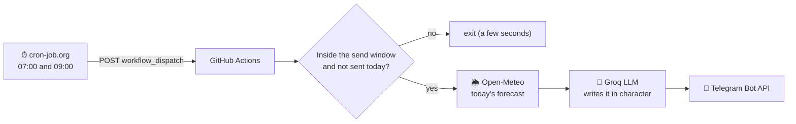

# telegram_morning ☀️🌧️

Every morning a Telegram message tells you today's weather, in the voice of a random character:
a Uruguayan grandma worried you'll catch a cold, Don Quijote fighting cloud-giants, a vampire who
hates sunny days, a football radio commentator… 38 characters, Spanish or English.

**It costs $0 to run, needs no server, and your computer can be off.**

```
👵 Abuela

¡Buen día, mi amor! ¿Ya desayunaste? ☕ Mirá que hoy en Montevideo hay chubascos y un viento que te
vuela hasta las ideas. Bufanda, campera y paraguas, ¡y no me discutas! ☔ Si llegás mojado te hago
unas tortas fritas y un mate bien calentito. […] Abrigate, que después andás con la garganta. 💕

🌦️ Montevideo: chubascos · 12.2–13.9°C · lluvia 81% · viento 32.1 km/h
```

## Contents
- [How it works](#how-it-works)
- [What it costs](#what-it-costs)
- [Set it up from scratch](#set-it-up-from-scratch)
- [Configuration](#configuration)
- [Characters and twists](#characters-and-twists)
- [Run it on your own computer (optional)](#run-it-on-your-own-computer-optional)
- [Troubleshooting](#troubleshooting)
- [Project structure](#project-structure)

## How it works



- Nothing runs all the time. A free timer (cron-job.org) asks GitHub to run the workflow at 07:00
  and 09:00. GitHub starts a short job (about 30 seconds), and the Python program decides whether
  to send.
- **Time zones and daylight saving** are handled by Python's `zoneinfo`: `send_time` is always your
  local wall-clock time, in winter and summer.
- **At most one message a day.** The date of the last send is kept in `state/last_sent.json`, which
  is carried between GitHub runs with the Actions cache. The 09:00 run is a backup: if 07:00
  already sent, it stops in seconds.
- **If the LLM fails**, you still get a plain forecast. Every message also ends with one line of
  real numbers, because some characters get them wrong on purpose.

## What it costs

| Service | Used for | Cost |
|---|---|---|
| [GitHub Actions](https://github.com/features/actions) | runs the code | Free. Public repos: unlimited. Private: 2,000 min/month, this uses ~60 |
| [cron-job.org](https://cron-job.org) | punctual daily timer | Free (donation-funded) |
| [Groq](https://console.groq.com) | LLM that writes the message | Free tier (rate-limited; 1 request a day is nothing) |
| [Open-Meteo](https://open-meteo.com) | weather forecast | Free, no API key (non-commercial use) |
| [Telegram Bot API](https://core.telegram.org/bots/api) | delivers the message | Free |

## Set it up from scratch

About 20 minutes. You need a GitHub account and Telegram.

### 1. Get your own copy
Fork this repo, or clone it and push it to a new repo of yours (private is fine).
In a fork, open the **Actions** tab once and enable workflows. GitHub turns them off in forks.

### 2. Create the Telegram bot
1. In Telegram, message **@BotFather** → `/newbot` → pick a name. It replies with the **bot token**
   (`123456789:AAH…`).
2. Open your new bot and press **Start**. A bot can't message you until you've written to it.
3. Message **@userinfobot**: the `Id` it replies with is your **chat id**.

### 3. Get a free Groq API key
Sign in at <https://console.groq.com> → **API Keys** → **Create API key**.

### 4. Edit `config.yaml`
At least these lines (the file is commented):
```yaml
language: es                    # or en
timezone: "America/Montevideo"  # any IANA name, e.g. "Europe/Madrid"
send_time: "07:00"              # local time the send window opens
send_window_minutes: 240        # window stays open until 11:00
location:
  city: "Montevideo"
character_selection: random     # random | sequential | fixed
```
Commit and push. Editing the file on github.com works too.

### 5. Add the secrets to GitHub
Repo → **Settings → Secrets and variables → Actions → New repository secret**, three times:

| Name | Value |
|---|---|
| `TELEGRAM_BOT_TOKEN` | the token from @BotFather |
| `TELEGRAM_CHAT_ID` | your id from @userinfobot |
| `GROQ_API_KEY` | your Groq key |

### 6. Send a test message
Repo → **Actions → telegram-morning → Run workflow**, tick **Send a message right now**, and
optionally type a character id such as `quijote`. The message arrives in about a minute.

### 7. Set up the daily timer (cron-job.org)
GitHub has a built-in scheduler, but on small repos it delays or silently drops most runs (in
testing it ran 2 out of ~28 times overnight). cron-job.org calls GitHub's API on time instead.

**a. A GitHub token that can only start this workflow**
<https://github.com/settings/personal-access-tokens/new>. GitHub first asks you to confirm it's you.
- Repository access: **Only select repositories** → your copy of this repo
- Permissions: **Actions → Read and write** (nothing else)
- Pick the longest expiration offered and write the date down. Copy the token.

**b. The cron job** — sign up at <https://cron-job.org> → **Create cronjob**:
- **URL:** `https://api.github.com/repos/<your-user>/<your-repo>/actions/workflows/morning.yml/dispatches`
- **Schedule:** every day at **07:00**. Set your time zone in the **Advanced** tab.
- **Advanced:** request method **POST**, request body `{"ref":"master"}` (use your default branch,
  e.g. `main`), and these headers:

  | Key | Value |
  |---|---|
  | `Authorization` | `Bearer <your token>` |
  | `Accept` | `application/vnd.github+json` |
  | `X-GitHub-Api-Version` | `2022-11-28` |
  | `Content-Type` | `application/json` |
- **Notifications:** turn on alerts for failed runs.

**c. The 09:00 backup.** Duplicate the job and change the time to **09:00**. Copies are created
**disabled**, so switch it on.

**d. Test run** → it should answer **204**. If today's message hasn't been sent and you're inside the
window, it sends one.

That's it. From now on it runs by itself.

## Configuration
Everything lives in `config.yaml`; secrets live in GitHub secrets (or `.env` when running locally;
see `.env-example`).

| Field | Meaning |
|---|---|
| `language` | `es` or `en` |
| `timezone` | IANA name, e.g. `America/Montevideo` (DST automatic) |
| `send_time` | local `HH:MM` when the send window opens |
| `send_window_minutes` | how long it stays open. Keep your timer's times inside it |
| `location.city` / `latitude`+`longitude` | where to get the weather |
| `weather.units` | `metric` or `imperial` |
| `llm.provider` | `groq` (default), `openai`, `openrouter`, or `ollama` (local) |
| `llm.fallback_provider` | tried if the first one fails (or `null`) |
| `llm.providers.<name>` | `base_url`, `model`, `api_key_env`, optional `extra_params` |
| `message.show_character_name` | start with the character's label, e.g. "🛡️ Don Quijote" |
| `message.append_forecast` | end with one line of real numbers |
| `character_selection` | `random`, `sequential` (one per day in order), or `fixed` |
| `character` | the character id used when `character_selection: fixed` |
| `surprise.twist_chance` / `surprise.twists` | chance (0–1) of adding a random twist each day |
| `characters` | the roster (see below) |

Any OpenAI-compatible LLM works without code changes: add it under `llm.providers`, add its key as
a secret, and pass it in the workflow's `env:` list.

## Characters and twists
38 characters, each with an emoji, a display name and a persona in Spanish and English. A few:

- **Getting things wrong on purpose:** 🛡️ Don Quijote, 🧅 Sancho Panza, 📱 a fat-thumbed texter, 📺 a TV
  weatherman who swaps the numbers, 🌐 a broken translator, 🔮 a fortune teller, 🧒 a six-year-old
- **Local flavour:** 👵 a Uruguayan grandma, 🧉 a gaucho, 📻 a football radio commentator
- **Dramatic:** 🌹 a telenovela narrator, 🦹 a supervillain, 🧛 a vampire, 🎖️ a drill sergeant
- **Classics:** 🏴‍☠️ pirate, 🕵️ detective, 🔬 scientist, 🤖 robot, 🐈 cat, 🐕 dog…

**Twists:** on some days (40% by default) the character also gets a random instruction, such as
"you have a terrible cold and sneeze mid-word" or "you're writing from a stuck elevator".

To add a character, add an entry under `characters:`. Describing *how* they talk (mistakes, slang,
obsessions) works better than describing who they are:
```yaml
  - id: abuela
    emoji: "👵"
    name: { es: "Abuela", en: "Grandma" }
    persona:
      es: "una abuela uruguaya cariñosa que teme que te resfríes: insiste con la bufanda…"
      en: "a loving Uruguayan grandma terrified you'll catch a cold: insists on a scarf…"
```

## Run it on your own computer (optional)
Needs pyenv and Poetry (`brew install pyenv poetry`). Then:
```bash
make setup                  # Python 3.11 + dependencies, creates .env and config.yaml
make dry                    # write a message and print it, don't send
make dry CHARACTER=quijote  # try a specific character
make send                   # send one now
make check                  # would it send right now?
make test                   # unit tests
```
To use a local model instead of Groq: install [Ollama](https://ollama.com), run `make ollama-pull`,
and set `llm.provider: ollama`. GitHub's servers can't reach your computer, so schedule it locally
with one of the files in `deploy/` (cron, macOS launchd, or Linux systemd) at 07:00 and 09:00. Your
computer must be awake at those times.

## Troubleshooting
These all happened while building it.

- **No message in the morning:** check the cron job's history on cron-job.org.
  - `204`: the call worked. Open the run in GitHub **Actions** and read the *Run telegram_morning*
    step.
  - `401`: the token is wrong or expired. Make a new one.
  - `404`: wrong URL, or the token can't see the repo.
  - `422`: wrong `ref` in the body (branch name).
- **The run says "Skipping: Not in window":** the timer and `send_time`/`send_window_minutes`/
  `timezone` don't line up.
- **The message ends with "(mensaje sin LLM: …)":** the LLM call failed and the plain forecast was
  sent instead. The run log shows why. `404` usually means the model was retired from Groq's free
  tier; pick a current one from <https://console.groq.com/docs/models>.
- **Telegram "chat not found":** wrong chat id, or you never pressed **Start** on your bot.
- **The workflow doesn't appear in the Actions tab after the first push:** GitHub sometimes doesn't
  register a new workflow until something triggers it. Push any change to `config.yaml`.
- **A push shows a red ❌:** the tests or the config check failed. The log says which setting.

## Project structure
```
telegram_morning/
├── telegram_morning/           # the program
│   ├── main.py                 # entry point and CLI flags
│   ├── config.py               # loads and validates config.yaml + secrets
│   ├── scheduler.py            # send window, time zone/DST, once-a-day guard
│   ├── weather.py              # Open-Meteo forecast
│   ├── characters.py           # picks the character and the twist
│   ├── llm.py                  # any OpenAI-compatible LLM, with fallback
│   └── telegram_client.py      # sends the message
├── tests/test_core.py          # unit tests (no network)
├── .github/workflows/morning.yml
├── deploy/                     # cron / launchd / systemd, for running on your computer
├── config.yaml                 # your settings
├── config.example.yaml         # template
├── .env-example                # secrets template (local runs)
├── Makefile                    # make setup / dry / send / test …
└── pyproject.toml, poetry.lock # Python 3.11 + Poetry
```
